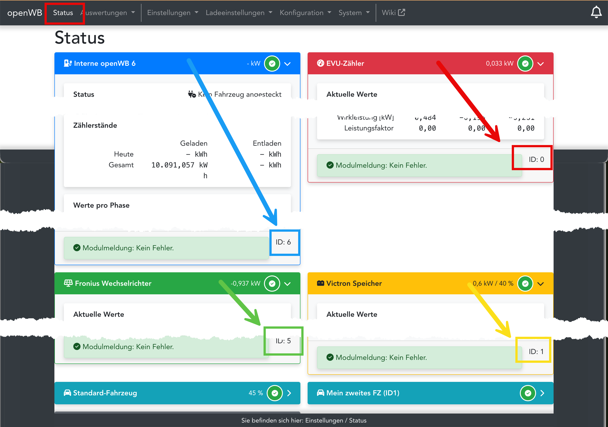

# openWB Integration for Home Assistant

This custom integration connects your [openWB](https://openwb.de) wallbox (software version 2.x) to Home Assistant. You can monitor and control your charging setup directly from your Home Assistant dashboard.

The integration uses the **openWB simpleAPI** and connects in one of two ways:
1.  **API (HTTP):** recommended, the simplest setup.
2.  **MQTT:** instant updates, needs an MQTT bridge.

---

## What's New in 2.0.0

Version 2.0.0 is a major rework. Please read this before you update.

*   **simpleAPI only.** Both connection methods now use the openWB simpleAPI. The old MQTT topics (`openWB/chargepoint/...`, `openWB/set/...`) are no longer used.
*   **MQTT users must change the bridge.** Only one line is needed now: `topic openWB/simpleAPI/# both 2` (see [4.2](#42-mqtt-configuration)).
*   **Your entity IDs stay the same.** Existing entries are migrated automatically on the first start. History, dashboards and automations keep working.
*   **Device types "Controller" and "Vehicle" were removed.** Existing entries of these types show a repair notice and no longer create entities. Please delete them. You can build totals (for example the total charging power) with Home Assistant helpers such as "Sensor group" or a template sensor.
*   **New device type "Consumer".**
*   **New entities**, among others:
    *   Charge limits for PV charging (limit type, SoC limit, energy limit) and min. SoC for PV charging
    *   Battery mode for PV charging ("Speicherbeachtung") and reserved battery power
    *   Charge limitation message and reason, openWB Pro SoC, serial number and software version
*   **Fixes**, among others: ECO and Target Charging now show and work correctly, Standby is no longer offered (it cannot be set), counter power can be used in the Energy dashboard, empty values no longer cause errors.
*   **New options:** optional API token and an option to turn off the SSL certificate check (for openWB with user management).
*   **Some entities are no longer provided** on one or both connection methods, because the simpleAPI does not deliver them (see [5.6](#56-entities-that-are-no-longer-provided)). They stay in Home Assistant as "unavailable"; you can delete them.

---

## 1. Requirements

*   **Home Assistant 2026.8** or newer.
*   **openWB software 2.x with the current simpleAPI.** Please update your openWB to the latest version. Older versions of the simpleAPI deliver some values in other units or not at all (tested with openWB 2.3.0-RC.2).
*   For MQTT: the [MQTT integration](https://www.home-assistant.io/integrations/mqtt/) and an MQTT broker (for example the Mosquitto add-on).

---

## 2. Which Method Should I Choose?

For most users, the **API method is recommended**.

| Method | Pros | Cons |
| :--- | :--- | :--- |
| **API (HTTP)** | Simple setup in the Home Assistant UI. All controls act on the right chargepoint. | Values are updated every 15 seconds (polling). |
| **MQTT** | Instant updates. | Needs an MQTT bridge. The charge limit controls always act on the chargepoint with the lowest ID (see [6](#6-good-to-know)). |

Each device (chargepoint, counter, ...) is added either via API or via MQTT, not both.

---

## 3. Installation

1.  **Install via HACS (recommended):**
    *   Make sure you have [HACS](https://github.com/hacs/integration) installed.
    *   Add this repository as a custom repository in HACS.
    *   Search for "openWB2" and install the integration.
2.  **Manual installation:**
    *   Copy the `custom_components/openwb2mqtt` folder into your Home Assistant `custom_components` folder.

After installation, **restart Home Assistant**.

---

## 4. Configuration

Add one integration entry per device: go to **Settings > Devices & Services**, click **Add Integration** and search for `openWB`.

*How to find the Device ID:* the IDs are shown on the status page of your openWB.


### 4.1 API (HTTP) Configuration (Recommended)

The simpleAPI is documented [here](https://wiki.openwb.de/doku.php?id=openwb:vc:2.1.9:simpleapi#openwb_simpleapi_http).

1.  **Communication method:** select **HTTP API**.
2.  **API prefix:** a name that identifies your openWB, for example `openWB`. It becomes part of the entity IDs.
    *   **If you switch from MQTT:** enter your previous MQTT root topic here to keep your entity IDs and history.
3.  **API URL:** replace `openwb.local` with the IP address or host name of your openWB, for example `http://192.168.1.123/openWB/simpleAPI/simpleapi.php`.
4.  **API token (optional):** only needed if the simpleAPI of your openWB is protected with a token.
5.  **Verify SSL certificate:** leave it on. Only turn it off if you use HTTPS with a self-signed certificate (for example openWB with user management).
6.  **Device type and Device ID:** choose the device (Chargepoint, Counter, PV Generator, Battery, Consumer) and enter its ID.

The integration checks the connection and the device ID before it creates the entry.

### 4.2 MQTT Configuration

#### Step 1: MQTT bridge
The integration reads the simpleAPI topics from your own MQTT broker. Create a bridge from your broker to the broker of the openWB:

1.  In the configuration folder of your Mosquitto broker, create a file, for example `openwb.conf`. You can use `mosquittoExampleConfiguration.conf` from this repository as a template.
2.  Add:
    ```
    connection openwb2
    local_clientid openwb2.mosquitto
    address 192.168.1.123:1883
    topic openWB/simpleAPI/# both 2
    ```
    Replace the IP address with the address of your openWB. If you use another root topic than `openWB`, replace it here as well.
3.  Restart your MQTT broker.

**Updating from version 1.x:** replace all old `topic` lines in your bridge with the single line above.

#### Step 2: Add the integration
1.  **Communication method:** select **MQTT**.
2.  **MQTT root topic:** usually `openWB`.
3.  **Device type and Device ID:** as above.

### 4.3 Chargepoint Options
For a chargepoint, you see an additional step. You can change these values later with **Configure** on the integration entry.

1.  **Wallbox power:** select `11 kW` or `22 kW`. This sets the maximum of the current controls (16 A or 32 A).
2.  **Vehicles (API only):** the vehicles you want to select in Home Assistant.
    *   **Format:** `id=Name, id=Name`, for example `0=My EV, 1=Guest Car`.
    *   The vehicle ID is shown in openWB. Each ID and each name may only be used once.

---

## 5. Devices and Entities

The tables show the entity names as they appear in Home Assistant. "Both" means the entity exists for API and MQTT. Entities marked "off" are disabled by default; you can enable them in the entity settings.

### 5.1 Chargepoint

| Type | Entities | API | MQTT |
| :--- | :--- | :---: | :---: |
| Sensor | Ladeleistung, Leistung (L1–L3), Strom (L1–L3), Spannung (L1–L3), Frequenz, Aktive Phasen | ✔ | ✔ |
| Sensor | Geladene Energie (Heute / Gesamt), Entladene Energie (Heute / Gesamt, off), Geladene Entfernung (off) | ✔ | ✔ |
| Sensor | Ladezustand, Fehlerbeschreibung, Ladepunkt, Lademodus, Fahrzeug, Fahrzeug-ID, Ladung (SoC) | ✔ | ✔ |
| Sensor | Min. Dauerstrom (PV-Laden), Max. Preis (Strompreisbasiertes Laden), SoC (openWB Pro), SoC-Datenaktualisierung (openWB Pro, off) | ✔ | ✔ |
| Sensor | Ladebegrenzung (Meldung), Ladebegrenzung (Grund, off), Zuletzt gescannter RFID-Tag (off), RFID-Zeitstempel (off), Ladestromvorgabe (off), Leistungsfaktor (L1–L3, off) | ✔ | ✔ |
| Sensor | Lade-Profil, Soll-Ladestrom (Sofortladen), Mindeststrom (Lademodus, off) | ✔ | – |
| Sensor | Ladestrom (aktuell), Ladeleistung (aktuell, off), Ladespannung (aktuell, off), SoC-Datenaktualisierung (off), Seriennummer, Version | – | ✔ |
| Binary sensor | Ladekabel, Autoladestatus, Fehler | ✔ | ✔ |
| Select | Lademodus (Instant, PV, ECO, Target Charging, Stop), Begrenzung (Sofortladen), Begrenzung (PV-Laden) | ✔ | ✔ |
| Select | Angeschlossenes Fahrzeug (off) | ✔ | – |
| Number | Soll-Ladestrom (Sofortladen), Min. Dauerstrom (PV-Laden), Energie-Limit and SoC-Limit (Sofortladen), Energie-Limit and SoC-Limit (PV-Laden), Min. SoC (PV-Laden), Max. Preis (Strompreisbasiertes Laden) | ✔ | ✔ |
| Number | Aktueller SoC (Manuelles SoC Modul) | ✔ | – |
| Lock | Manuelle Sperre | ✔ | ✔ |

### 5.2 Counter
Leistung, Leistung (L1–L3), Strom (L1–L3), Spannung (L1–L3), Leistungsfaktor (L1–L3, off), Frequenz, Importierte / Exportierte Energie (Heute / Gesamt), Fehlerbeschreibung, binary sensor Fehler. All on API and MQTT.

### 5.3 Battery
Ladung (SoC), Leistung, Geladene / Entladene Energie (Heute / Gesamt), Strom (L1–L3, off), Fehlerbeschreibung, binary sensors Fehler and Leistungsbegrenzung steuerbar (off).
Controls: select **Speicherbeachtung** (battery mode for PV charging: Fahrzeuge, Speicher, Speicher-Mindest-SoC) and number **Reservierte Speicherleistung**. All on API and MQTT.

### 5.4 PV Generator
Leistung, Strom (L1–L3), Zählerstand (Heute / Monat / Jahr / Gesamt), Fehlerbeschreibung, binary sensor Fehler. Importierte Energie (Gesamt, off) on MQTT only.

### 5.5 Consumer
Leistung, Leistung / Strom / Spannung (L1–L3, off), Importierte Energie (Heute / Gesamt), Exportierte Energie (Gesamt, off), Aktive Phasen, Status, Fehlerbeschreibung, binary sensors Aktiv and Fehler. All on API and MQTT.

### 5.6 Entities that are no longer provided
These entities are no longer created. Existing ones stay as "unavailable" and can be deleted.

*   All entities of the device types Controller and Vehicle.
*   API and MQTT: "Vehicle ID" (use "Fahrzeug-ID").
*   API: "SoC-Datenaktualisierung" (the API only delivers the openWB Pro timestamp, now "SoC-Datenaktualisierung (openWB Pro)").
*   MQTT: "Aktueller SoC (Manuelles SoC Modul)", "Angeschlossenes Fahrzeug", "Lade-Profil", sensor "Soll-Ladestrom (Sofortladen)".

---

## 6. Good to Know

*   **Prices** ("Max. Preis") are shown and set in **€/kWh**.
*   **Controls without a read value show the last value you sent.** After a restart of Home Assistant they are "unknown" until you set them again. This applies to:
    *   API: Min. SoC (PV-Laden), Speicherbeachtung, Reservierte Speicherleistung
    *   MQTT: Soll-Ladestrom (Sofortladen), Speicherbeachtung, Reservierte Speicherleistung
*   **MQTT: charge limit controls act on the chargepoint with the lowest ID.** The simpleAPI has no chargepoint ID for these commands: Begrenzung, SoC-Limit and Energie-Limit (Sofortladen and PV-Laden). With several chargepoints, use the API method for them.
    *   If these controls do nothing at all, your openWB may still publish topics of a deleted chargepoint with a lower ID (for example `openWB/chargepoint/4/...`). Check with MQTT Explorer.
*   **"Aktueller SoC (Manuelles SoC Modul)"** only has an effect if the vehicle uses the manual SoC module in openWB. Otherwise openWB ignores the value and the entity shows the real SoC again after the next update.
*   **API:** after a change, Home Assistant shows the new value at once; the next poll (15 s) shows what openWB really uses. **MQTT:** the new value appears when openWB confirms it (about 1 second).

---

## 7. Switching Between API and MQTT

Your entity IDs and history are kept if the API prefix (API) and the MQTT root topic (MQTT) are the same.

1.  Note the **MQTT root topic** or **API prefix** of the existing entry (it is part of the entity IDs, for example `sensor.openwb_chargepoint_6_ladeleistung` for `openWB`).
2.  Delete the existing entry.
3.  Add the integration again with the other method and enter the same value as API prefix or MQTT root topic.

For a video overview of the API setup and the migration, click below (recorded with version 1.x, the steps are the same):

[](https://www.youtube.com/embed/7lbCmwPlw7s)

---

## 8. Troubleshooting & FAQ

*   **"Cannot connect to the openWB" during setup.**
    *   Open `http://<IP of your openWB>/openWB/simpleAPI/simpleapi.php?get_chargepoint_all=<ID>` in a browser. If you don't get values, the simpleAPI is not available; update your openWB.
    *   Check the API URL (only replace the host) and the API token.
    *   HTTPS with a self-signed certificate: turn off "Verify SSL certificate".
*   **"The openWB does not know a device of this type with this ID."** Check the device ID on the status page of your openWB.
*   **"The MQTT integration is not set up."** Set up the MQTT integration first, or use the API method.
*   **MQTT: no values.** Check that your bridge contains `topic openWB/simpleAPI/# both 2` and that you restarted the broker. In MQTT Explorer, you should see topics below `openWB/simpleAPI/`.
*   **A command is sometimes ignored.** This can happen in openWB itself (also with plain HTTP requests). Try again.
*   **My values only update every 15 seconds.** This is expected for the API method.
*   **Which topic belongs to which entity?** See [`MQTT_Topic_Reference.md`](custom_components/openwb2mqtt/MQTT_Topic_Reference.md).
*   **Reporting a problem:** please attach the diagnostics of the entry (integration entry > ⋮ > Download diagnostics). The API token is removed automatically.
